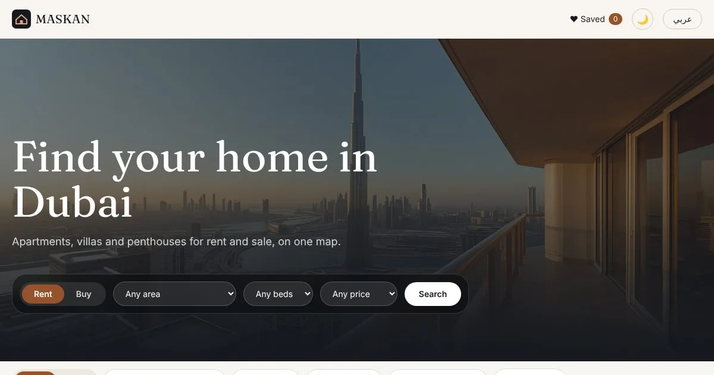

# MASKAN — Dubai Real Estate Map (TypeScript)

A bilingual English / Arabic website for homes in Dubai, written in strict TypeScript.

**Live:** [maskan-real-estate.vercel.app](https://maskan-real-estate.vercel.app) · Part of my [portfolio](https://aya-khamaysa-portfolio.vercel.app)



## Highlights

- **Interactive map:** price pins on OpenStreetMap stay in sync with the listing cards (hover one, the other lights up).
- **Filters and sorting:** rent / buy, area, bedrooms, max price; sort by price or size.
- **Saved homes** (♥), remembered in the browser.
- **Compare up to 3 homes** side by side, including price per sq ft.
- WhatsApp and call buttons on every home, light / dark mode, English / Arabic (RTL).

## TypeScript
The project was migrated from JavaScript to TypeScript in strict mode.
- `src/types.ts` holds the data model: `Home`, `Filters`, `Deal`, `Feature`, `Lang`.
- Area and property-type keys are derived from the data (`keyof typeof areas`), so the types never drift from the content.
- The Arabic UI texts are typed against the English ones (`UiText`): a missing or misspelled key fails the build.
- `featuresAr` is a `Record<Feature, string>`: every feature must have an Arabic name.
- Values read from `localStorage` are validated before use.
- `npm run build` type-checks first, so a type error never reaches production.

## Built with

React 19 · **TypeScript (strict)** · Vite · Tailwind CSS v4 · React Leaflet + OpenStreetMap · Framer Motion

## Run locally

```bash
npm install
npm run dev        # local development
npm run typecheck  # TypeScript check only
npm run build      # type-check + production build
```

## Edit
- Agency, areas and homes: `src/data/homes.ts`
- Texts (English / Arabic): `src/data/ui.ts`

> MASKAN is a fictional agency for a portfolio concept.

---

Designed & built by **Aya Khamaysa** · [Portfolio](https://aya-khamaysa-portfolio.vercel.app) · [LinkedIn](https://www.linkedin.com/in/ayakhamaysa) · [One Click](https://www.instagram.com/oneclick.ps)
